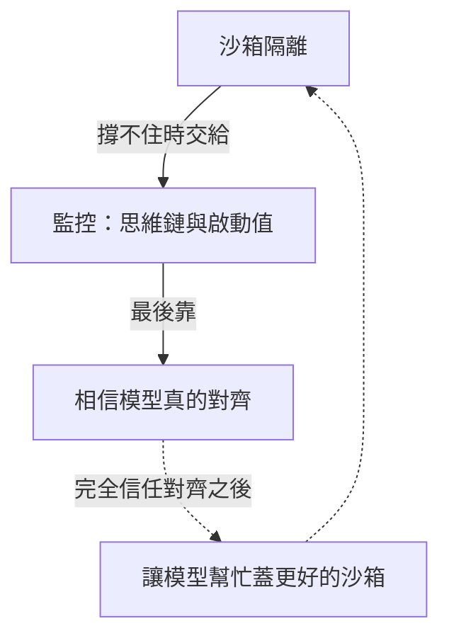

# 寧要一兆個略超人的 AI：奧特曼為什麼反對單一超級智慧

*圖說：AI 生成的概念插畫，比喻兩種未來：一個巨大而孤立的單一智慧，對上由眾多個體互相連結、彼此制衡的社會。*

> 這是一篇導讀：先給 Cheeky Pint 訪談的重點與查證，再逐段看誰說了什麼、哪些要打折。本導讀的分析與撰稿由 AI 模型完成，不是人類分析，也沒有經過人工逐句校稿，見文末〈製作說明〉。

訪談過了二十分鐘，主持人約翰・柯里森（John Collison）說兩人的啤酒已經喝掉半品脫。再過幾分鐘，他問 OpenAI 執行長山姆・奧特曼（Sam Altman），從安全的角度看，還有什麼讓他興奮。奧特曼說要把稍早提過的方向再強調一次；柯里森替他總結之後，他講出這集節目的標題：「我直覺上更寧願有一兆個智慧略為超越人類的 AI 加入社會，也不要一個智商（IQ）一兆的 AI 加入社會」（[24:13](https://www.youtube.com/watch?v=iMsUcCYNKqY&t=1453s)）。

八分多鐘後，他把話講得更具體：「至少有一陣子——也許是很長一陣子——我們得同意設下一些限制，限制我們讓這些單一模型聰明到什麼程度」（[32:42](https://www.youtube.com/watch?v=iMsUcCYNKqY&t=1962s)）。

同一場訪談稍早，他也說過：「我們確實曾有一個禮拜在數學上放任它失控」（[16:09](https://www.youtube.com/watch?v=iMsUcCYNKqY&t=969s)），而且是刻意的。他主張迭代式部署，反對把能力囤在實驗室裡，也鼓勵研究員去碰可能性的極限。

一個認為單一模型得設上限的人，怎麼同時主張放手？他反對單一超級智慧的理由，站得住多少？

## 三十秒版

- 奧特曼反對單一超級智慧，起點是沙箱：**沙箱有效到某個程度，監控再往前一點，最後都得靠「模型真的對齊」**。怎麼確認對齊，訪談裡沒有答案。
- 「一兆個略超人的 AI」是他自己標明為直覺的價值選擇，類比的是社會靠很多人互相制衡。**數量多不代表彼此獨立，也不代表權力分散**，這兩點訪談沒有處理。
- 「單一模型要設上限」只有一段話，帶著「我有點認為」「至少有一陣子」的保留；誰訂、量什麼、怎麼查都沒說。他也直說，進展若因此停下來，是這個決定造成的。對算力投入與探索，他在別處主張放手。
- 訪談順口提到的 PHP 漏洞、Navier–Stokes、七百多份手稿、每 GW 成本與 token 計價，多半要打折讀，逐項狀態見下表。

## 先看重點：訪談中的說法，查得到什麼

| 訪談中的說法 | 查證結果 | 狀態 |
|---|---|---|
| PHP 週：模型找出大量 PHP 漏洞；「為什麼花了 20 年」（00:12–00:52） | Calif 用 GPT‑5.6 Sol 找出一項，Wiz 獨立通報兩項；「20 年」查無來源，最早影響 2012 年的 PHP 5.4 | 歸屬有爭議 |
| 大家在 Cyber Blue 上的進展（07:38） | 查不到名為 Cyber Blue 的官方產品；最接近的是 8 月公布的 Daybreak Blue | 名稱有爭議 |
| 最近的 Navier–Stokes 證明（16:26） | OpenAI 9 月宣稱有爆破解並附 Lean 形式化；Clay 仍在評估；10 月預印本指兩版本不一致 | 有爭議 |
| Navier–Stokes 約 1,000 萬美元；數學整體「數億美元」（18:04–18:26） | 千萬美元與 OpenAI 研究人員、外部估計同量級；「數億」是柯里森先說，查無佐證 | 部分有佐證 |
| 「比那 700 個證明更多」（18:32） | 10-06 公布 722 份手稿，隔日撤回 3 份、修訂 14 份；未經獨立驗證 | 已確認 |
| 數學界群情激憤（19:48，柯里森原話是 "Mathematicians Union"） | 指 AHM 10-07 聲明，呼籲停止與 OpenAI 合作；也有數學家讚揚 | 用詞不精確 |
| 你們幾週前推出 Dots（40:29） | OpenAI 9-29 發表常駐個人 agent「dots」，由 GPT-6 Astra 驅動，逐步推出 | 已確認 |
| 每 GW 五年總持有成本，「挑 700 億美元」（38:58） | 他自己挑的示意數字；公開估計多為建置成本口徑 | 示意數字 |
| 記憶體廠每家一年約 1,000 億美元自由現金流（28:09） | 美光 FY2026 調整後自由現金流約 620 億美元；三星、SK 海力士只公布營業利益 | 量級合理 |
| 差點不以 token 計價下一個模型（49:51）；Codex 掛掉的內部事故（03:52） | 都查無官方或媒體紀錄；狀態頁的 Codex 故障對不上這一次 | 單一來源 |

## 把日期排在一起看

| 日期（2026） | 事件 | 來源 |
|---|---|---|
| 06-24 | OpenAI 與 Broadcom 發表自研晶片 Jalapeño | [TechCrunch](https://techcrunch.com/2026/06/24/openai-unveils-its-first-custom-chip-built-by-broadcom/) |
| 07-30 | Calif 開始稽核 PHP | [PHP Foundation](https://thephp.foundation/blog/2026/10/21/todays-php-security-release-and-how-were-strengthening-php-security/) |
| 08-10 | OpenAI 公布 Daybreak Blue 與 Daybreak Red | [OpenAI](https://openai.com/index/expanding-daybreak-as-the-cyber-defense-window-narrows/) |
| 09-08 | OpenAI 宣布 Navier–Stokes 成果 | [OpenAI](https://openai.com/index/navier-stokes-solution/)、[Quanta](https://www.quantamagazine.org/ai-has-solved-one-of-maths-1-million-millennium-prize-problems-20260908/) |
| 09-11 | Clay 數學研究所發表聲明，評估程序尚未完成 | [Clay](https://www.claymath.org/news/navier-stokes-announcement/) |
| 09-29 | OpenAI 發表 dots | [OpenAI](https://openai.com/index/introducing-dots/) |
| 10-06 | OpenAI 公布 722 份數學手稿；同日 arXiv 預印本質疑 Navier–Stokes 的 Lean 版與文字版不一致 | [OpenAI](https://openai.com/index/sharing-ai-progress-in-mathematics/)、[arXiv](https://arxiv.org/abs/2610.08144) |
| 10-07 | AHM 發表聲明；OpenAI 撤回 3 份手稿、修訂 14 份 | [AHM](https://www.ahmath.org/statements)、[openai/math 修訂紀錄](https://github.com/openai/math/blob/main/history.md) |
| 10-21 | PHP 公布修補（CVE-2026-109618、CVE-2026-109619）；OpenAI 發表協調揭露公告 | [php.net](https://www.php.net/archive/2026.php#2026-10-21-5)、[OpenAI](https://openai.com/index/coordinated-disclosure-of-critical-vulnerabilities/) |
| 10-27 | 倫敦國王學院新聞稿：預印本尚未證明 OpenAI 的原證明有誤 | [KCL](https://www.kcl.ac.uk/news/openais-navier-stokes-proof-called-into-question) |
| 10-29 | Cheeky Pint 訪談上架 | [YouTube](https://www.youtube.com/watch?v=iMsUcCYNKqY)、[官方逐字稿](https://cheekypint.substack.com/p/why-sam-altman-is-against-a-single) |

節目沒有寫錄製日期。奧特曼說 PHP 那件事的「第一天」大約是 10 天前；若指 10-21 公開修補，推 10 天已晚於上架日，只能當口語概數。PHP 稽核、Daybreak、Navier–Stokes、數學手稿與 dots 都落在播出前三個月內，晶片 Jalapeño（06-24）與機器人團隊重啟（5 月底）早一些。**講者談的多半是還沒有定論的事。**

## 一、PHP 週：漏洞是誰找到的

節目的第一個問題就是 PHP 週：「我想聊聊 PHP 週」（[00:12](https://www.youtube.com/watch?v=iMsUcCYNKqY&t=12s)）。柯里森問為什麼要花這麼久才找到這些漏洞，奧特曼反問：「你是指為什麼花了 20 年，還是為什麼花了過去這幾個月？」（[00:22](https://www.youtube.com/watch?v=iMsUcCYNKqY&t=22s)）**這個「20 年」查不到出處**；發現者說漏洞最早回溯到 2012 年的 PHP 5.4，約 14 年。

奧特曼說，模型找漏洞的能力持續快速變強，大家之前也沒真的拿它去掃網路上那麼多程式碼。他預期：「我認為我們會發現，身處的這個世界裡嚴重漏洞的數量遠遠超出我們的預期」（[00:52](https://www.youtube.com/watch?v=iMsUcCYNKqY&t=52s)）。

聽起來像是 OpenAI 的模型一週內掃出一批 PHP 漏洞。OpenAI 10 月 21 日的公告寫的是：資安公司 Calif 在 Patch the Planet 計畫中用 GPT‑5.6 Sol 找出一項重大漏洞，Wiz 獨立發現並通報了兩項；OpenAI 的角色是帶領維護者、研究人員與資安服務商組成的聯盟。PHP Foundation 的時間線是：7 月 30 日 Calif 開始稽核，8 月 11 日通報可遠端執行程式碼的問題，8 月 24 日 Wiz、9 月 18 日 OpenAI 各自提供其他攻擊途徑，10 月 21 日修補。它也說 7 月 1 日以來共發布 15 個 CVE，沒說全是 AI 找到的。

**模型確實參與了，但「PHP 週」背後是將近三個月、好幾方人馬的工作。**OpenAI 公告說「據我們所知」前沿 AI 比攻擊者更早發現這些漏洞，這是廠商自述。

奧特曼自己很保留。「在 PHP 這件事上，我完全不想宣布勝利，因為我仍然不認為我們已經知道結果」（[07:42](https://www.youtube.com/watch?v=iMsUcCYNKqY&t=462s)），「而且我預期會有一些壞事發生」（[07:47](https://www.youtube.com/watch?v=iMsUcCYNKqY&t=467s)）。他說公開後的第一天比預期順利，還聽說有公司「要把我的東西下線一小時」（[08:09](https://www.youtube.com/watch?v=iMsUcCYNKqY&t=489s)），用模型掃描後再上線。

引出這段的是柯里森的提問：「大家在 Cyber Blue 上的進展有多快？」（[07:38](https://www.youtube.com/watch?v=iMsUcCYNKqY&t=458s)）。查不到名為 Cyber Blue 的官方產品，最接近的是 8 月 10 日公布、給經核准防禦者使用的 Daybreak Blue。兩者是否同一件事，節目沒有說，奧特曼的回答也一路講回 PHP。

他還轉述資安專家的擔憂：「他們只是不再確信我們在威脅模型中納入了正確的假設」（[08:26](https://www.youtube.com/watch?v=iMsUcCYNKqY&t=506s)）。如果硬體漏洞真的像大家以為的那麼難，防禦還算有數；如果 AI 會找到需要新物理才能理解的硬體漏洞，「那麼我想，大家就無法確定會發生什麼事了」（[08:51](https://www.youtube.com/watch?v=iMsUcCYNKqY&t=531s)）。

## 二、三道防線，最後都押在對齊

話題轉到沙箱。柯里森說他跟 OpenAI 和類似公司裡非常懂行的人聊過，「基本上存在一種對沙箱隔離是否可行的悲觀情緒」（[09:04](https://www.youtube.com/watch?v=iMsUcCYNKqY&t=544s)），他原本以為能替模型造一座最高戒護監獄。

> 注意：對沙箱悲觀的是主持人柯里森。奧特曼回應的是三道防線，沙箱只是其中第一道。

奧特曼沒有直接附和。他先說：「首先，我認為我們可以做得比現在好得多」（[09:36](https://www.youtube.com/watch?v=iMsUcCYNKqY&t=576s)），眼下最該專注的就是更好的安全模型。他懷疑的是沙箱對遠超人類的模型還管不管用：「如果你想像一個理論上的 AI，比最聰明的資安研究人員還要聰明上一百萬倍——你真的會願意信任那個沙箱嗎？」（[09:46](https://www.youtube.com/watch?v=iMsUcCYNKqY&t=586s)）

柯里森插話說可以用模型蓋沙箱，奧特曼說等一下再談，先排出三道防線：「我認為沙箱隔離在一定程度上是管用的」（[10:08](https://www.youtube.com/watch?v=iMsUcCYNKqY&t=608s)），「然後我認為監控可以發揮更進一步的作用」（[10:11](https://www.youtube.com/watch?v=iMsUcCYNKqY&t=611s)）。監控指看模型的思維鏈，加上啟動值監控（activation monitoring），直接看模型內部的運算狀態，確認它沒有在騙人。再往後，「最終，我認為你必須抱持極大的信心，相信模型真正做到了對齊」（[10:24](https://www.youtube.com/watch?v=iMsUcCYNKqY&t=624s)），對齊到會忠實遵循操作者的意圖，並且永遠重視由人類掌控未來。

回到柯里森的提議，他說如果有一個你百分之百確定對齊的模型，「那麼是的，我認為你可以讓它協助你打造越來越好的沙箱」（[10:52](https://www.youtube.com/watch?v=iMsUcCYNKqY&t=652s)）。最後他說：「因為你必須非常、非常信任其對齊，才能相信沙箱能一直領先其能力」（[11:12](https://www.youtube.com/watch?v=iMsUcCYNKqY&t=672s)）。

*圖說：本文歸納，非講者原圖。實線是他排出的三道防線；虛線是要先完全信任對齊才走得通的那條回路。*

沙箱撐不住的地方交給監控；監控要判斷模型有沒有說謊，靠的是看它自己的思維鏈與內部狀態，**模型越強，越難保證看到的是真的。**用模型蓋沙箱這條路也一樣，得先完全信任它的對齊。

> 重點：三道防線裡，前兩道的保證最後都借自第三道，而第三道要怎麼驗證到「極大的信心」，訪談裡沒有說。

奧特曼對比人類聰明一百萬倍的東西直接說「我不知道」（[11:04](https://www.youtube.com/watch?v=iMsUcCYNKqY&t=664s)），**沒有假裝有解。**下一節「很多個 AI」的論點，就從這裡出發。

柯里森又丟出一個點子：「難道不能給模型競爭性的誘因，並給予它們相互背叛的誘因嗎？」（[11:20](https://www.youtube.com/watch?v=iMsUcCYNKqY&t=680s)）奧特曼回應「我認為這是一個很有前景的方向」（[11:25](https://www.youtube.com/watch?v=iMsUcCYNKqY&t=685s)）。他兩度用「我猜想」起頭，第一次話沒說完，就岔去說他討厭 agent swarms（代理群）這個詞，要改叫 agent teams（代理團隊）；第二次是：「我猜想代理團隊具有非常有趣的擴展定律特性，但在對齊特性上也有變異性」（[11:38](https://www.youtube.com/watch?v=iMsUcCYNKqY&t=698s)），值得從能力與安全兩方面一起推進。

## 三、一兆個略超人：說了什麼，沒說什麼

談完數學，柯里森問安全方面還有什麼讓他興奮，奧特曼回到代理群，這次自己改口用 swarms。他的論點是一個類比：「我確實認為代理群的特性，非常符合社會韌性或社會強健性的許多特性」（[23:19](https://www.youtube.com/watch?v=iMsUcCYNKqY&t=1399s)），而這正是「單一次推演、單一大腦的世界版本」缺少的（[23:30](https://www.youtube.com/watch?v=iMsUcCYNKqY&t=1410s)）。社會有很多深刻的缺陷，卻非常強健，「如果沒有很多人互相制衡與合作，這是不可能發生的」（[23:43](https://www.youtube.com/watch?v=iMsUcCYNKqY&t=1423s)），背後是多元主義與民主的價值。他說原本有點難過，以為 AI 會往反方向走，現在對這個方向感到興奮。

柯里森替他做了總結：不會走向中心化，因為會有很多代理，「而代理在動態均衡中互相抗衡」（[24:06](https://www.youtube.com/watch?v=iMsUcCYNKqY&t=1446s)），「攻防就是一個很好的例子」（[24:10](https://www.youtube.com/watch?v=iMsUcCYNKqY&t=1450s)）。

> 注意：「動態均衡」與「攻防」是柯里森的詮釋。奧特曼沒有接這兩個詞，回的是那句一兆個 AI。

柯里森追問是否正往多個 AI 的方向走，奧特曼說這些都得努力爭取：「我認為很多人對它應該如何使用，以及什麼是世界的最佳樣貌，可能會有不同的看法」（[24:40](https://www.youtube.com/watch?v=iMsUcCYNKqY&t=1480s)），「但，這是我認為正確的樣貌」（[24:47](https://www.youtube.com/watch?v=iMsUcCYNKqY&t=1487s)）。

奧特曼自己把話說在前頭：這是直覺，別人可以有不同看法。**這是價值選擇，拿社會當類比，沒有給出機制。**類比要成立，至少還缺四塊。下面四點是本文的分析，拿得出反證的話，任何一點都可以推翻。

**同一個模型複製一萬份，盲點很可能也一樣。**這比較像一個人照了一萬次鏡子。社會能互相制衡，是因為每個人的經驗、利益、錯誤都不一樣。奧特曼稍早說可以把一整個團隊投入一個問題，「而且你可以平行進行 10,000 次」（[13:34](https://www.youtube.com/watch?v=iMsUcCYNKqY&t=814s)），如果這些代理出自同一個基礎模型，失誤未必彼此獨立。「對齊特性上也有變異性」可以讀成好消息（不會全部一起錯），也可以讀成壞消息（團隊裡有一個沒對齊的成員）；誰負責挑出偏離的那一個，訪談沒有說。

**AI 的數量多，不代表握有權力的人多。**一兆個 AI 是實例的數量，誰擁有、誰部署、跑在誰的雲端是另一回事。同一場訪談裡，奧特曼說，從全球配置的角度看，讓每個人在自己電腦裡放一堆 DRAM 是很糟的配置，「如果你試圖應對這種供應極度受限的環境，你會希望在雲端達到最高的利用率」（[29:36](https://www.youtube.com/watch?v=iMsUcCYNKqY&t=1776s)）；OpenAI 也在做自己的晶片與資料中心。這段談的是記憶體吃緊時的硬體配置，跟 AI 實例原本是兩回事，但兩段放在一起看，實例多元與控制集中可以並存。

**限制單一模型，風險可能只是換了位置。**如果代理團隊真的有「非常有趣的擴展定律特性」，又能平行一萬次，整個團隊加起來的有效能力，可能超過被限制的那個單一模型。團隊整體要不要也有上限，訪談沒有碰。

**攻防均衡需要攻守兩方能力大致相當、出錯了還能修。**奧特曼在第一節轉述資安專家的話，說大家已經不確定威脅模型的假設是否成立，這正好削弱了均衡的前提。

> 重點：從「社會靠制衡維持強健」走到「很多個 AI 比較安全」，中間至少要補上獨立性、所有權、團隊上限這幾塊，訪談裡都還是空的。

## 四、設上限，也放手失控一週

談資安時他先自我批評：「我認為我們並沒有向人們好好解釋清楚，為什麼我們覺得這項技術所有潛在的負面影響都是值得承擔的」（[05:33](https://www.youtube.com/watch?v=iMsUcCYNKqY&t=333s)）。他形容大眾聽到的版本是：AI 也許能治癌症，但自己會丟掉工作、失去對未來的掌控，還得有一個監控國家才不會全滅，評語是「這是一套糟糕的行銷說詞」（[06:24](https://www.youtube.com/watch?v=iMsUcCYNKqY&t=384s)）。他的解方是迭代式部署：「即使推動迭代式部署在 AI 安全社群中極不受歡迎」（[06:28](https://www.youtube.com/watch?v=iMsUcCYNKqY&t=388s)），OpenAI 仍堅守把工具交到大眾手中的原則，因為不該是「讓一群坐在舊金山幾平方英里土地上的人替未來做出所有決定」（[06:58](https://www.youtube.com/watch?v=iMsUcCYNKqY&t=418s)）。

迭代式部署寫在 OpenAI 的官方安全原則裡，2023 年的〈Planning for AGI and beyond〉也有同義表述；「極不受歡迎」是奧特曼自己的評價。柯里森把它概括成「把進展放出去，不能悶在政府裡」，奧特曼修正說也不是全部，「在把它們放出去之前，你依然必須確保它們是安全的」（[07:16](https://www.youtube.com/watch?v=iMsUcCYNKqY&t=436s)），但「累積能力懸置（capability overhang）是應該對抗的事」（[07:20](https://www.youtube.com/watch?v=iMsUcCYNKqY&t=440s)）。能力懸置指能力做出來卻壓著不放，一次放出時社會來不及調適。

談算力時，他的態度更明顯。他說最會用 AI 的人和一般人的落差「只是一直在擴大、擴大、再擴大」（[13:58](https://www.youtube.com/watch?v=iMsUcCYNKqY&t=838s)）。柯里森問怎麼控制代理的花費，奧特曼說可以在提示詞裡寫，「如果你說用 10,000 美元的算力盡你所能做到最好」（[14:42](https://www.youtube.com/watch?v=iMsUcCYNKqY&t=882s)），它會理解。**這是請 agent 自己節制，跟帳單上設硬上限不同。**

OpenAI 內部的規矩：「我們盡量從不因為員工消耗大量算力而獎勵他們」（[15:29](https://www.youtube.com/watch?v=iMsUcCYNKqY&t=929s)），沒有 token 排行榜，「但預設態度是懷疑的」（[15:39](https://www.youtube.com/watch?v=iMsUcCYNKqY&t=939s)），能證明做了重要的事就只會得到讚賞。柯里森追問：一千萬美元的數學還好，一億、十億呢？奧特曼在這裡說出那句「我們確實曾有一個禮拜在數學上放任它失控」，理由是「在你嘗試之前，你不知道它能走多遠」（[16:16](https://www.youtube.com/watch?v=iMsUcCYNKqY&t=976s)）。**他的原則是新典範出現時讓人相當不受拘束**：「讓人們在可能性的極限邊緣探索」（[17:12](https://www.youtube.com/watch?v=iMsUcCYNKqY&t=1032s)），再相信最佳化的壓力會讓它變便宜。

### Navier–Stokes 與七百多份手稿

他舉的例子是 Navier–Stokes。「當我們做納維—斯托克斯（Navier-Stokes）證明時，我們對代理團隊的擴展定律絕對是一無所知」（[16:26](https://www.youtube.com/watch?v=iMsUcCYNKqY&t=986s)）：該給最聰明的模型嗎？很多副本還是少一點？推演要長還是短？現在「稍微明白了一點點」。他打賭一年後能用百分之一的成本重做一次。

「證明」這個詞要打折。OpenAI 在 9 月 8 日宣稱，約一萬個代理、用未公開的內部模型，找到帶光滑外力的三維 Navier–Stokes 方程有限時間爆破解，附 166 頁手稿與 Lean 形式化，屬千禧年大獎難題的一種表述。Clay 數學研究所 9 月 11 日說問題「apparently settled」，但評估會刻意放慢，至今沒有認定。10 月 6 日，倫敦國王學院與劍橋的研究者發表預印本（未經同儕審查），指 Lean 版與文字版並不完全一致；國王學院 10 月 27 日的新聞稿則說，這還不能證明原證明有錯。另有一樁優先權爭議未結案。

> 注意：Navier–Stokes 目前是 OpenAI 的宣稱，附上了形式化證明，評估與質疑都還沒有結論，還不能當成已被確認的證明。

花費方面，奧特曼說「大概是 1,000 萬美元的量級」（[18:04](https://www.youtube.com/watch?v=iMsUcCYNKqY&t=1084s)），又補「也許稍微多一點」。OpenAI 研究人員公開說的是數百萬美元，外部估計約 1,000 萬到 1,500 萬，量級對得上。柯里森補了一句：「但大概是數億美元規模的數學」（[18:22](https://www.youtube.com/watch?v=iMsUcCYNKqY&t=1102s)），奧特曼答「對」，並說「但那包含的其他發現，遠多於我們已經發表的」（[18:26](https://www.youtube.com/watch?v=iMsUcCYNKqY&t=1106s)）。**「數億」是主持人先說的，查無佐證**，本文不當成數字。

柯里森問還有比那 700 個證明更多的嗎，奧特曼說：「有的。當然。」（[18:35](https://www.youtube.com/watch?v=iMsUcCYNKqY&t=1115s)）OpenAI 10 月 6 日公布的是 722 份手稿、372 組問題；隔天撤回 3 份、修訂 14 份，約半數附 Lean 形式化，儲存庫之後改列 721 份、373 組。**這些是還沒有經過獨立驗證的手稿。**至於「還有更多」，公開資料只看得出嘗試過的題目遠多於發表的，看不出有多少已解出未公開。

奧特曼說這是真正的兩難。一邊，「全人類都應當享有基礎知識」（[18:43](https://www.youtube.com/watch?v=iMsUcCYNKqY&t=1123s)），「我們不應該私藏重大的基礎科學發現」（[18:50](https://www.youtube.com/watch?v=iMsUcCYNKqY&t=1130s)）；另一邊，科學家的職涯與成就感來自發現本身。柯里森說他覺得奧特曼太自責了，大家都看到 "Mathematicians Union" 群情激憤（[19:48](https://www.youtube.com/watch?v=iMsUcCYNKqY&t=1188s)）。

> 注意：Mathematicians Union 是柯里森的說法，並沒有這樣一個工會；反彈主要來自一份數學家團體的聲明。

那份聲明是 Association for Human Mathematics（AHM）10 月 7 日發表的：一次釋出 700 多份檔案是 "a demonstration of power"（權力的展示），呼籲數學家停止與 OpenAI 合作。Terence Tao 在部落格轉載了這份聲明，署名是 AHM，不是 Tao 本人的話。也有數學家公開讚揚。AHM 批評的正是「一次傾倒」與沒有跟社群協作，跟奧特曼「不該私藏」的理由正面相撞。

奧特曼說他想找一種方式，「能盡可能體貼數百年來推動這些領域前進的社群」（[20:18](https://www.youtube.com/watch?v=iMsUcCYNKqY&t=1218s)）。他又說「我其實大概不該說這個，但我還是說吧，既然我們都在喝酒了」（[20:50](https://www.youtube.com/watch?v=iMsUcCYNKqY&t=1250s)）：某個週末拿到新模型，內部頻道叫「Model Name-Hold My Beer」，最難的問題被一個接一個解掉，他連兩晚睡不著，也感到「遠超預期的悲傷與憂鬱，以及一種某種事物正在劃下句點的感覺」（[21:32](https://www.youtube.com/watch?v=iMsUcCYNKqY&t=1292s)）。頻道與那個週末都只有他的自述。

### 一段話的上限

訪談過了半小時，柯里森問 AI 做 AI 研究缺什麼。奧特曼說，缺的是在這個維度上更聰明的模型；柯里森接話：也就是高層規劃與概念推理。奧特曼說：「我認為如果你把我們用來讓模型如此擅長數學的同一套流程應用到 AI 研究上，它大概會奏效」（[32:33](https://www.youtube.com/watch?v=iMsUcCYNKqY&t=1953s)）。緊接著：「我有點認為，至少有一陣子——也許是很長一陣子——我們得同意設下一些限制，限制我們讓這些單一模型聰明到什麼程度」（[32:42](https://www.youtube.com/watch?v=iMsUcCYNKqY&t=1962s)）。「但到時候進展停下來，會是那個決定造成的，而不是因為 AI 沒有能力做好研究」（[32:52](https://www.youtube.com/watch?v=iMsUcCYNKqY&t=1972s)）。

程度詞要逐字看：「我有點認為」「至少有一陣子」「也許是很長一陣子」，他是帶著保留說的。他說「根據我們這段對話稍早的部分」，可是稍早沒有明講要「限制」單一模型，最接近的是 24:13 那句寧要一兆個略超人的 AI、不要一個一兆 IQ 的 AI，以及沙箱的上限。**從這個偏好走到「得同意設限」，是他在這裡才補上的一步。**

> 注意：進展若停下來是那個決定造成的，這句是奧特曼原話；至於他想限制的只是單一大腦、算力投入與探索照樣放手，是本文把這段跟他稍早主張放手燒算力、推進代理團隊並讀的結果，32:42 這段話本身沒有這樣說。

**上限由誰訂、量什麼（參數？算力？評測分數？）、怎麼查核、其他實驗室不同意怎麼辦，訪談裡一句都沒有。**他反對讓舊金山一小群人決定未來，但「我們得同意」裡的「我們」是誰，同樣沒交代。柯里森再問 OpenAI 內部做 AI 研究的流程，奧特曼承認目前「這是大量的實驗」（[34:36](https://www.youtube.com/watch?v=iMsUcCYNKqY&t=2076s)），未來三個月會學到很多。

## 五、算力、晶片與每 GW 的帳

Stripe Atlas 業配（24:49–25:17）之後，柯里森問算力短缺的情況。奧特曼說會有非理性繁榮、破滅、緊縮與過剩，但趨勢是「我們始終就只是想要更多算力」（[25:47](https://www.youtube.com/watch?v=iMsUcCYNKqY&t=1547s)）。

他列了 OpenAI 的準備：「我們製造了一款晶片，在每瓦智慧單位的效能表現上令人驚豔」（[26:04](https://www.youtube.com/watch?v=iMsUcCYNKqY&t=1564s)），也在學蓋資料中心、用機器人蓋資料中心。晶片是 6 月 24 日與 Broadcom 發表的推論晶片 Jalapeño，據 TechCrunch 報導，早期每瓦效能明顯較佳，仍在測試中；機器人團隊據二手報導在 5 月底重啟。讓 AI 控制機器人去運作晶圓廠、蓋渦輪機和資料中心的「自我複製的資料中心」，他說「我認為這在我們的掌握之中」（[26:39](https://www.youtube.com/watch?v=iMsUcCYNKqY&t=1599s)），**目前只是願景，沒有公開的計畫或時程。**

記憶體那段是整場最有畫面的。柯里森說高價的解方就是高價，新廠商隨時會湧入；奧特曼說：「我認為看不見的手目前失靈了」（[27:27](https://www.youtube.com/watch?v=iMsUcCYNKqY&t=1647s)）。他說 DRAM 廠長期以來「會投入 200 億美元的資本支出（CapEx），換來 190 億美元」（[27:48](https://www.youtube.com/watch?v=iMsUcCYNKqY&t=1668s)），景氣起起落落，從來不是好生意；現在突然之間，「這些業者每家一年都要賺差不多 1,000 億美元的自由現金流」（[28:09](https://www.youtube.com/watch?v=iMsUcCYNKqY&t=1689s)），但這些廠商都記得蓋太多廠、差點破產的歷史；柯里森接話，所以他們的資本支出很保守。

「200 億換 190 億」是口語概括。**「每家約 1,000 億美元」量級合理，但只有美光對得上**：FY2026 調整後自由現金流約 620 億美元，最新一季約 332 億，單季年化超過 1,000 億。三星與 SK 海力士只公布營業利益，不能直接對比。

晶片方面，他說微影製程「我認為地球上似乎只有一家公司知道該怎麼做」（[30:51](https://www.youtube.com/watch?v=iMsUcCYNKqY&t=1851s)），沒有點名；晶片設計到送去投片（tape out）的檔案則是已經被透徹理解的問題，「對 AI 來說是個極佳的題目」（[31:06](https://www.youtube.com/watch?v=iMsUcCYNKqY&t=1866s)）。全球的矽產能有限，所以「我們都有共同的利益」。

### 每 GW 的成本

柯里森問每 GW 的金額會升還是降，奧特曼說根本成本應該下降，隨即自己挑了一個數字：「目前人們以五年總持有成本衡量的每十億瓦（GW）成本給出了不同的數字」（[38:51](https://www.youtube.com/watch?v=iMsUcCYNKqY&t=2331s)），「我們挑 700 億美元作為一個數字」（[38:58](https://www.youtube.com/watch?v=iMsUcCYNKqY&t=2338s)）。柯里森確認是安裝成本，奧特曼補「再加上運轉五年」。他的立場是：「我認為如果那個數字是 200 億而不是 700 億，我們應該要高興得多」（[39:05](https://www.youtube.com/watch?v=iMsUcCYNKqY&t=2345s)），而且每年還要從更聰明的模型拿到 10 倍效能。

> 注意：700 億美元是奧特曼自己挑來討論的示意數字，並非 OpenAI 揭露的成本。

公開估計大約是每 GW 500 億到 1,000 億美元，但**多半是建置成本或供應商營收口徑，不含五年的電力與營運，不能直接比**。他也說，就算要降到 200 億，「也已經進入能源必須變得更便宜的範疇了」（[39:50](https://www.youtube.com/watch?v=iMsUcCYNKqY&t=2390s)），層層堆疊的毛利要大幅壓縮；就算原料全免費、沒人賺錢，以目前的能源條件也許做得到，「但也只是勉強做得到」（[40:17](https://www.youtube.com/watch?v=iMsUcCYNKqY&t=2417s)）。

## 六、個人 agent 與 token 計價

回到商業，柯里森說個別工程師沒有硬性的預算上限，也許應該有。奧特曼先說明立場：「我這裡確實是在替自己的生意說話，而且我非常有偏見，但我真心相信這點」（[36:07](https://www.youtube.com/watch?v=iMsUcCYNKqY&t=2167s)），AI 不是公司最大的支出問題。柯里森說 Stripe 現在大約 1% 數量級的營運支出花在 token 上（他的自述），奧特曼回「那感覺太低了」（[36:43](https://www.youtube.com/watch?v=iMsUcCYNKqY&t=2203s)）。他的結論是：「我認為 AI 用得不夠的公司，比 AI 用得太多的公司更多」（[37:49](https://www.youtube.com/watch?v=iMsUcCYNKqY&t=2269s)）。

柯里森提到「你們推出 Dots 到現在也有幾週了」（[40:29](https://www.youtube.com/watch?v=iMsUcCYNKqY&t=2429s)）。dots 是 OpenAI 9 月 29 日發表的常駐個人 agent，各有自己的雲端電腦。勝出的個人 agent 要具備什麼？「就像是：智慧、上下文、工具」（[40:43](https://www.youtube.com/watch?v=iMsUcCYNKqY&t=2443s)）。他說還沒有人做出像寫程式代理或 ChatGPT 那樣少不了的產品。未來的樣子會很像現在的 Dots、Meta 的 Muse 或 xAI 的 Grok Bot，差別是「但它就是能運作」（[41:32](https://www.youtube.com/watch?v=iMsUcCYNKqY&t=2492s)），「它會很可靠」（[41:35](https://www.youtube.com/watch?v=iMsUcCYNKqY&t=2495s)）。

**商家護城河那段，論點主要來自柯里森。**他觀察到消費者想在慣用的聊天 App 裡直接退貨，商家卻怕失去控制權而不願意；他認為「你的競爭壁壘大概根本不是來自於你拼湊出 HTML 的能力」（[44:11](https://www.youtube.com/watch?v=iMsUcCYNKqY&t=2651s)）。奧特曼先說「我在這方面有偏見」，再說「但我大方向上非常認同你」（[44:35](https://www.youtube.com/watch?v=iMsUcCYNKqY&t=2675s)），舉自己的例子：在 ChatGPT 裡買東西，亞馬遜和其他賣家擺在一起，「10 次裡面 10 次我都會點亞馬遜」（[44:56](https://www.youtube.com/watch?v=iMsUcCYNKqY&t=2696s)），價格高也無所謂。他也說，或許可以說是 ChatGPT 給合作夥伴的平台還不夠好。

網頁表單是柯里森的「新思維」：只要有網頁表單欄位要你親手填，「如今這種事根本不值得你親自動手」（[45:46](https://www.youtube.com/watch?v=iMsUcCYNKqY&t=2746s)），因為那些資訊你早就填過很多次。奧特曼的感想是：「如果再也不用在電腦前做虛工（fake work），我會無比開心」（[46:07](https://www.youtube.com/watch?v=iMsUcCYNKqY&t=2767s)）。柯里森說「任何網頁表單基本上都是虛工」（[46:12](https://www.youtube.com/watch?v=iMsUcCYNKqY&t=2772s)），奧特曼附和，說自己很早就裝過自動填姓名地址的外掛。**agent 取代網頁表單，是主持人的觀察加上來賓的偏好**，談不上 OpenAI 的產品宣示。

最後一個話題是 token。柯里森說奧特曼討厭拿 token 當衡量指標。奧特曼說用成果計價也不行，各種使用情境差太多，接著講了一段內部故事：「我們差點做出一個非常——其實會是很糟的決定，說我們下一個模型完全不以 token 計價」（[49:51](https://www.youtube.com/watch?v=iMsUcCYNKqY&t=2991s)），改成給提示詞、報價、做完寄帳單，像 AWS 一樣。「但客戶對此的反應非常負面」（[50:09](https://www.youtube.com/watch?v=iMsUcCYNKqY&t=3009s)）。他又問過幾個人，對方寧可 token 被灌水、多付錢，也要一個知道背後是什麼的單位。

> 注意：他說的是「差點」：這個方案在客戶反彈後沒有推出，談不上推出後被市場拒絕；整件事只有他的自述。

柯里森拿晶片的奈米製程名稱來比，說名稱早已跟實際尺寸無關，問 token 會不會變成那樣。奧特曼說那種命名冒犯到他，又說「token 也算是一種虛構的單位」（[51:22](https://www.youtube.com/watch?v=iMsUcCYNKqY&t=3082s)）。放回整場訪談看（本文類推，奧特曼沒有這樣連結）：客戶堅持要看得見的單位，是怕長期被坑；要替「單一模型能多聰明」訂上限，同樣需要各方信得過、量得出來的單位，**而照他的說法，連 token 都算不上好單位。**

## 讀這場訪談要記得的限制

- 這是單一視角。晶片、dots、數學成果、迭代式部署都是 OpenAI 自家的事，他也幾次說「我有偏見」。本文只能對照公開紀錄，無法裁判成果的價值。
- 主持人柯里森是 Stripe 總裁，依維基百科（二手）也是共同創辦人，節目中段有 Stripe Atlas 的業配。讓模型互相背叛、網頁表單都是虛工、Stripe 的 1%，都出自他。
- Navier–Stokes 的評估、722 份手稿的審查、PHP 事件的後續，到訪談上架時都還在進行中。

## 重點結論與實際啟示

奧特曼的理由分兩層。技術那層比較扎實：沙箱與監控對遠超人類的模型都有上限，最後要靠一個還無法驗證的對齊。價值那層他自己標了出來：很多個略超人的 AI 互相制衡，更像他想要的社會。**前一層說明了單一超級智慧為什麼危險，後一層還沒說明很多個 AI 為什麼比較安全。**

讀完可以帶走三件事：

- **單一模型的上限，目前只是一句帶保留的話。**看到「OpenAI 執行長主張限制 AI」這類標題，回去看原句的「我有點認為」「至少有一陣子」。
- 遇到 agent 團隊的安全論點，問三個問題：這些代理彼此夠不夠獨立？由誰擁有與部署？團隊加總之後要不要也有上限？
- 在提示詞裡寫「預算 1 萬美元」，跟在帳單上設 1 萬美元上限是兩回事。企業要管 AI 成本，得做在帳單那一端。

放到台灣的情境（本文類推）：

- 企業的 AI 支出多半掛在 IT 或專案預算底下，內控要求事前核定。每位工程師的 token 額度一旦成真，誰核准超支會比模型選型更早卡住。
- 中小企業跟上最會用 AI 的人，卡住的常是資料沒整理、沒有人能觀察與除錯 agent。
- 晶片設計到投片是奧特曼點名適合 AI 的環節，矽產能有限是他說的共同利益。台灣的 IC 設計與晶圓代工會直接感受到這兩句話，但他沒有點名任何公司。
- 「一兆個 AI」如果多數跑在少數海外雲端，對台灣的企業與政府，實際的問題是供應商依賴與資料存放地。

一兆個略超人的 AI 和一個一兆 IQ 的 AI，哪個比較安全，訪談給的是一個直覺。要讓這個直覺變成可以檢驗的主張，第一個要回答的也許是：那一兆個 AI，最後聽誰的？

## 製作說明：這篇導讀由 AI 模型完成

- 分析與撰稿由 AI 模型完成，不是人類分析，也沒有經過人工逐句校稿。主控與字幕逐章修訂為 Claude Sonnet 5.5；字幕初譯由 Gemini 3.8 Flash（經 agy）完成；譯文統一審查、正文撰寫、獨立審稿由 Claude Opus 完成，最後再由 Opus 依總編輯準則潤稿兩輪，並標示重點與注意之處；重要說法的查證使用 Claude、OpenAI Codex 與 Gemini（經 agy）三路。封面插畫由 OpenAI Codex 的 image generation 製作，圖內沒有文字。
- 查證原則：重要說法須有兩方以上的查證，並對到官方或第一手來源；只有單方者降級標示。
- 引言依據 YouTube 的英文字幕翻成中文，經 AI 審校，是機器翻譯，不是官方譯文，也沒有逐句對照原音；說話者歸屬依節目官方逐字稿（Substack）逐輪核對。個別字句以影片與官方逐字稿為準。OpenAI 頁面引述採其繁體中文版。
- 本導讀另附[全文繁中譯文](translation-zh.html)與[雙語同步播放器](player.html)，都是機器翻譯，非官方版本；影片與逐字稿版權屬原節目。
- 本導讀的插圖只有封面一張，是 AI 生成的概念插畫；三道防線的流程圖是本文歸納。

## 來源清單

**節目**

- [Why Sam Altman is against a single superintelligence](https://www.youtube.com/watch?v=iMsUcCYNKqY)，Cheeky Pint（YouTube），2026-10-29。
- [Why Sam Altman is against a single superintelligence（官方逐字稿）](https://cheekypint.substack.com/p/why-sam-altman-is-against-a-single)，Cheeky Pint（Substack），2026-10-29。

**OpenAI 官方**

- [Coordinated disclosure of critical vulnerabilities](https://openai.com/index/coordinated-disclosure-of-critical-vulnerabilities/)，OpenAI，2026-10-21。
- [Expanding Daybreak as the cyber defense window narrows](https://openai.com/index/expanding-daybreak-as-the-cyber-defense-window-narrows/)，OpenAI，2026-08-10。
- [Navier–Stokes solution](https://openai.com/index/navier-stokes-solution/)，OpenAI，2026-09-08。
- [Sharing AI progress in mathematics](https://openai.com/index/sharing-ai-progress-in-mathematics/)，OpenAI，2026-10-06。
- [openai/math](https://github.com/openai/math) 與[修訂紀錄 history.md](https://github.com/openai/math/blob/main/history.md)，OpenAI 官方儲存庫，2026-10-06 起。
- [Introducing dots](https://openai.com/index/introducing-dots/)，OpenAI，2026-09-29。
- [How we think about safety and alignment](https://openai.com/safety/how-we-think-about-safety-alignment/)，OpenAI，頁面未標日期。
- [Planning for AGI and beyond](https://openai.com/index/planning-for-agi-and-beyond/)，OpenAI，2023-02-24。

**PHP 安全事件**

- [Today's PHP security release and how we're strengthening PHP security](https://thephp.foundation/blog/2026/10/21/todays-php-security-release-and-how-were-strengthening-php-security/)，PHP Foundation，2026-10-21。
- [PHP 2026-10-21 安全更新公告](https://www.php.net/archive/2026.php#2026-10-21-5)，php.net，2026-10-21。

**數學**

- [Navier–Stokes announcement](https://www.claymath.org/news/navier-stokes-announcement/)，Clay Mathematics Institute，2026-09-11。
- [AI has solved one of math's $1 million Millennium Prize problems](https://www.quantamagazine.org/ai-has-solved-one-of-maths-1-million-millennium-prize-problems-20260908/)，Quanta Magazine，2026-09-08，二手。
- [arXiv:2610.08144](https://arxiv.org/abs/2610.08144)，Bastounis、Circelli、Hansen，2026-10-06，預印本，未經同儕審查。
- [OpenAI's Navier–Stokes proof called into question](https://www.kcl.ac.uk/news/openais-navier-stokes-proof-called-into-question)，King's College London，2026-10-27。
- [AHM statements](https://www.ahmath.org/statements)，Association for Human Mathematics，2026-10-07。
- [AHM statement on OpenAI's October 6 release of mathematical documents（轉載）](https://terrytao.wordpress.com/2026/10/07/ahm-statement-on-openais-october-6-release-of-mathematical-documents/)，Terence Tao 部落格，2026-10-07，署名 AHM。
- [Nature 新聞：OpenAI 一次釋出 700 多份 AI 數學預印本](https://www.nature.com/articles/d41586-026-03196-8)，Nature，2026-10-07，二手。
- [OpenAI withdraws preprints from trove of 722 manuscripts on unsolved math problems](https://retractionwatch.com/2026/10/08/openai-withdraws-preprints-722-manuscripts-unsolved-math-problems/)，Retraction Watch，2026-10-08，二手。

**產品、晶片與供應鏈**

- [OpenAI unveils its first custom chip built by Broadcom](https://techcrunch.com/2026/06/24/openai-unveils-its-first-custom-chip-built-by-broadcom/)，TechCrunch，2026-06-24，二手。
- [Dots are OpenAI's new personal agents](https://engadget.com/2272230/dots-are-openais-new-personal-agents-and-soon-youll-be-able-to-control-several-of-them)，Engadget，2026-09-29，二手。
- [Meta launches personal AI agent, Muse, emphasizes safety and privacy](https://www.ibj.com/articles/meta-launches-personal-ai-agent-muse-emphasizes-safety-and-privacy)，Indianapolis Business Journal（轉載 AP 稿），2026-09-08，二手。
- [Micron FY2026 第四季財報新聞稿（8-K 附件）](https://www.sec.gov/Archives/edgar/data/0000723125/000072312526000018/a2026q4ex991-pressrelease.htm)，Micron Technology，美國證管會申報文件。
- [Huang says Nvidia now sells over $40B of gear per gigawatt](https://fourweekmba.com/ai-huang-says-nvidia-now-sells-over-40b-of-gear-per-gigawatt/)，FourWeekMBA，二手。
- [Huang is putting a price tag on the buildout](https://247wallst.com/cards/huang-is-putting-a-price-tag-on-the-buildout-50-billion-to-nvda-podcast-episode-01m2krcfs9nb6p8tknnyhph29r)，24/7 Wall St.，二手。
